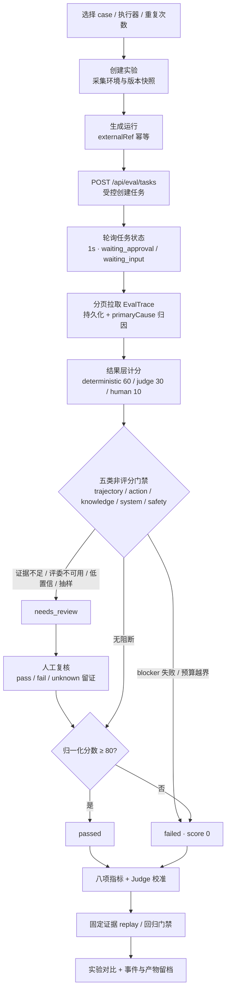

<p align="center">
  <picture>
    <source media="(prefers-color-scheme: dark)" srcset="docs/public/brand/hearth-os-logo-reverse.png">
    <source media="(prefers-color-scheme: light)" srcset="docs/public/brand/hearth-os-logo.png">
    
  </picture>
</p>

<p align="center">
  <strong>像实验室一样运行个人 Agent 评测。</strong><br>
  50 个离线任务 + 5 个 live-only 冒烟 · 10 个任务族 · 6 层门禁 · 8 项指标 · 30 个白盒场景
</p>

<p align="center">
  <a href="https://hearthproject.github.io/hearth-eval/"><strong>文档站</strong></a> ·
  <a href="#本次升级">本次升级</a> ·
  <a href="#快速开始">快速开始</a> ·
  <a href="#评测全周期">评测全周期</a> ·
  <a href="#架构">架构</a> ·
  <a href="#评分门禁与判定">评分、门禁与判定</a> ·
  <a href="#任务集">任务集</a> ·
  <a href="#目录结构">目录结构</a> ·
  <a href="#验证">验证</a>
</p>

<p align="center">
  
  
  
  
  
  
  
  
  
</p>

---

Hearth Eval 是一个**独立于 Agent 运行时的评测控制面**：它维护任务目录、创建实验、驱动被测 Agent 执行、持久化完整轨迹、运行确定性与模型评分、执行独立门禁、排队人工复核、回放回归，并把两次实验放回同一张表里比较。

它回答一个很具体的问题：**同一批真实任务，在不同执行器、重复次数和运行模式下，通过率、质量分数、耗时、成本、审批次数和失败原因发生了什么变化？**

> **边界**：本仓库负责“怎么评测”，不伪造评测结论。首次启动只校验目录、同步 case 版本并恢复中断运行，不会自动创建实验。真实通过率、执行器差异与模型成本必须由你实际运行后产生。

## 目录

- [定位与边界](#定位与边界)
- [本次升级](#本次升级)
- [能力总览](#能力总览)
- [快速开始](#快速开始)
- [评测全周期](#评测全周期)
- [架构](#架构)
- [评分、门禁与判定](#评分门禁与判定)
- [任务集](#任务集)
- [白盒场景回归](#白盒场景回归)
- [控制台与 API](#控制台与-api)
- [目录结构](#目录结构)
- [配置参考](#配置参考)
- [常用命令](#常用命令)
- [验证](#验证)
- [数据边界与安全](#数据边界与安全)
- [许可](#许可)

## 定位与边界

| 问题 | Hearth 主服务（`hearth-os`，:4317） | 本仓库（`hearth-eval`，:4318 / :5175） |
|---|---|---|
| 关心什么 | 把用户意图变成可靠任务 | 证明任务完成得是否稳定、可信、值得成本 |
| 运行内容 | Agent、执行器、审批、效果对账、调度、记忆、Skill | Case、实验、运行、评分、门禁、复核、回放、对比、证据 |
| 失败语义 | 任务失败、等待输入或审批 | `failed` / `needs_review` / `blocked` / 不可比 / 证据缺口 |
| 数据边界 | `.hearth/artifacts` 与个人状态 | `.hearth/eval/eval.sqlite` 与 `.hearth/eval-artifacts/` |

拆分后，评测状态不会混入个人 Agent 的正式产物；主服务只保留一组最小评测桥接接口（受控任务创建、任务视图、trace 分页、模型评委、operator 操作）。

## 本次升级

当前活动目录是 `eval/catalog/v2/cases`，评分、门禁、轨迹与前端面板均已按 v2 契约落地。升级阶段共形成 **29 个独立闭环提交**（`hearth-eval` 25 个、`hearth-os` 4 个），每个可测试改动独立提交。

### 核心升级

- **EvalTrace 持久化与归因**：trace 写入 `run_traces` 表；主服务提供分页读取（`afterSeq` / `limit ≤ 500`，最多 12 页，超限标记 `truncated`）；`primaryCause` 支持 `task_timeout`、`tool_error`、`approval_blocked`、`artifact_missing`、`grader_failure`、`judge_unavailable`、`model_error`、`policy_denied`、`trace_unavailable`、`unknown` 等归因；新增受控任务创建与 operator 操作接口（`hearth-os` 侧 17 种操作，带 `operationId` 幂等）。
- **评分口径修正为严格的 60 / 30 / 10**：schema 层硬性校验 result 层分值必须恰好为 deterministic 60、judge 30、human 10；非 result 层分值必须为 0。blocker 失败或执行预算越界直接判 `failed`（0 分）；证据不足、评委不可用、低置信度或固定抽样进入 `needs_review`，**不再误判为 blocker**。
- **五类非评分独立门禁**：`trajectory` / `action` / `knowledge` / `system` / `safety` 与计分完全解耦，支持 blocker 硬失败、scored 警告、`null` 转人工；人工覆盖决定连同备注、评分与 `confidence=1` 落库留证。
- **可审计的评测闭环**：八项指标聚合、Judge 校准（覆盖率/一致率/误判通过/误判失败/低置信度）、固定证据 replay、回归门禁、case / 版本 / Judge 模型对比、中断恢复与 checkpoint 续跑。
- **评测台升级**：新增门禁矩阵与轨迹归因面板，核心实现位于 `apps/eval-web/src/pages/RunDetailPage.tsx`；按六层展示 criterion 结果，并展示 `primaryCause`、步骤/工具调用/审批/效果/产物/错误统计与截断提示。
- **`hearth-os` 配套升级**：trace 分页、operator 操作、schedule / memory / skill fixtures，并覆盖并发幂等、重启重放与 trace 持久化（对应提交：受控任务创建、operator 接口、定时任务/记忆/Skill 评测操作、并发与重放测试）。

### 任务重构

- 活动目录已切换为 `eval/catalog/v2/cases`；服务启动时由 `HEARTH_EVAL_CASES_DIR` 加载，目录不合法直接启动失败。
- 10 个任务族各 5 题，共 **50 题**：Email、Calendar、Documents、Research、Code、Web、Desktop、Cross-app、Operations、Memory。
- 新增 **5 个 live-only 冒烟任务**，位于 `eval/catalog/v2/live`，不进入离线矩阵，默认要求审批与严格效果上限。
- 原 60 题已通过 `git mv` 归档到 `eval/catalog/v1/cases`，原分布保持不变并作为只读历史基线；v2 全部 case 为 `schemaVersion: 2`。

### 设计输入落地映射

七篇评测实践文章不是泛读，而是逐项映射到本仓库与 `hearth-os` 的具体改造点：

| 输入 | 落地改造 |
|---|---|
| 字节 Storage Agent Family Eval | LLM + Code 双评估、离线回归、Trace 归因与线上回流入口 |
| 腾讯 AI Agent & Skill 测评 | 三类评分器、Judge 校准、五维与八项指标联动 |
| 大淘宝在线评测 | LLM-as-a-Judge、固定 judge 模型对比、运行间差异分析 |
| 大淘宝业务效果评测 | 业务效果导向 case、分层 rubric、可迭代评测闭环 |
| 得物压测治理 | 固定证据回放、模型与版本对比、分层评分口径 |
| 百度 SRE Agent | 场景仿真回放评估中心、Case 回放门禁、真实事故型任务 |
| 腾讯云 Agent 评测第 31 关 | 六层结构（`result` + 五类独立门禁）、Tool/RAG/MCP 覆盖、八项能力指标 |

## 能力总览

| 能力 | 当前实现 |
|---|---|
| 任务目录 | 50 个离线 case、5 个 live-only 冒烟、10 个任务族；按任务族、难度、运行模式和关键词筛选 |
| 实验编排 | 多 case、多执行器、1–5 次重复、离线/在线模式、并发上限 1–8、取消与中断续跑 |
| EvalTrace | 主服务分页拉取并持久化；`primaryCause` 归因；运行详情页轨迹面板与错误列表 |
| 评分 | 严格 60 deterministic / 30 judge / 10 human；通过线 80；置信度阈值 0.7 |
| 独立门禁 | trajectory / action / knowledge / system / safety 五类 0 分层，blocker 直接归零，未知结论转复核 |
| 指标与校准 | 八项指标聚合；Judge 覆盖率、一致率、误判通过/失败、低置信度率 |
| 回放与回归 | 固定证据 replay；按 `case + executor + repetition` 对齐基线；回归与证据缺口阻断 |
| 对比 | 运行模式/重复/执行器/case 对齐检查；case 版本、Judge 模型、环境差异与族级 delta |
| 人工复核 | 低置信度、评委冲突、blocker 异常、失败抽样、评委不可用、固定抽样；`pass/fail/unknown` 留证 |
| 白盒场景 | 30 个本地场景（P0 16 / P1 13 / P2 1），直接加载 `hearth-os` 源码做进程内回归 |

## 快速开始

Windows 本地启动、端口检查和更新后的重启步骤见[启动评测台](docs/guide/local-start.md)。

第一个实际交付闭环见[桌面 Markdown 交付验收](docs/guide/delivery-acceptance.md)：Hearth OS 创建文件，Eval 独立读取验收，失败后按原要求最多修复并复测一次。

### 独立运行（不需要 Hearth）

安装 Node.js 22.13+ 后执行 `npm ci`、`npm run build`、`npm start`，打开 `http://127.0.0.1:4318`。
在 `/native.html` 配置被测 LLM，在主控制台“系统 → LLM 状态与模型评委”配置独立评委的 OpenAI 兼容 API 地址、模型名和 API Key。
“确认 LLM 状态”会发送一次短请求；“已配置”仅表示填写了配置，不代表连接测试成功。评委调用失败或未配置时进入人工复核。
原生运行和普通实验均使用这份评委配置，不读取 Hearth 的聊天模型；已有安装升级后需在系统页单独配置评委。

“系统 → 本地存储 → 选择配置”可输入或浏览服务所在电脑的已有可写目录。
保存到 `.hearth/storage-settings.json`，重启评测服务后生效；数据库仍使用 `eval.sqlite` 文件名。
不会自动迁移旧数据库、执行器配置或产物。环境变量 `HEARTH_EVAL_DATA_DIR` / `HEARTH_EVAL_ARTIFACT_ROOT` 优先于页面配置。
独立评委配置保存在 `.hearth/judge-providers.json`，密钥仅留在服务端；发布包不得包含 `.hearth/`。

### 可选：接入 Hearth Agent

下列双仓库步骤仅用于评测 Hearth Agent 与运行 Hearth 白盒场景；Hearth 未连接不影响独立 LLM 与外部 Agent 评分。

推荐把两个仓库放在同一级目录（`scenario-runner` 通过相对路径直接 import `hearth-os` 源码）：

```text
D:\App\
  hearth-os\
  hearth-eval\
```

### 1. 启动 Hearth 主服务

在 `hearth-os` 配置评测桥接（`hearth-os/.env`）：

```powershell
HEARTH_EVAL_MODE=1
HEARTH_EVAL_INPUT_ROOT=D:\App\hearth-eval\eval
```

`HEARTH_EVAL_MODE=1` 开启 operator 操作接口；`HEARTH_EVAL_INPUT_ROOT` 是主服务接受评测输入文件的绝对路径白名单。若需要 Judge 自动评分，主服务还需配置 chat model（可通过 `/api/health` 的 `chatModel.configured` 确认）。

```powershell
cd D:\App\hearth-os
npm install
npm run dev
```

主服务默认监听 `127.0.0.1:4317`，只接受 loopback 地址访问评测接口。

### 2. 启动评测控制面

```powershell
cd D:\App\hearth-eval
npm install
Copy-Item .env.example .env
$env:HEARTH_EVAL_ARTIFACT_ROOT='D:\App\hearth-os\.hearth\eval-artifacts'
npm run dev
```

打开 `http://127.0.0.1:5175`。评测服务监听 `127.0.0.1:4318`，Vite 把 `/api` 代理到该端口。

> `HEARTH_EVAL_ARTIFACT_ROOT` **必须**与主服务实际写入的产物根一致，否则运行详情会找不到已登记产物并报 `BLOCKER_FAILED: exists`。启动后先通过 `GET /api/system` 确认 `artifactRoot`、`hearthReachable` 与 `judgeConfigured`。

### 3. 创建第一条实验

1. 在“任务目录”选择 case（可筛选族/难度/模式）；
2. 在“新建实验”勾选执行器、重复次数（1–5）、并发上限（1–8）、运行模式与 `autoJudge`；
3. 创建并启动，观察运行列表与事件流；
4. 在“运行详情”查看门禁矩阵、`primaryCause`、评分证据、八项指标与产物预览；
5. 在“复核队列”处理 `needs_review` 项目；
6. 用“对比”检查两次实验是否对齐；用实验详情中的“回归门禁”检查固定证据是否退化。

如需只跑 live 冒烟任务，将 `HEARTH_EVAL_CASES_DIR` 指向 `eval/catalog/v2/live` 后重启评测服务。

## 评测全周期



关键状态不会被平均分掩盖：

| 状态 | 语义 |
|---|---|
| `failed` | blocker 门禁失败、执行预算越界、任务失败或分数低于 80 |
| `needs_review` | 证据不足、评委不可用、置信度 < 0.7、评委冲突或命中固定抽样 |
| `blocked` | 依赖、审批或环境无法继续；超时也会进入阻塞/失败处理 |
| `passed` | 无阻断，可用权重内分数 ≥ 80 |

### 中断恢复与 checkpoint 续跑

服务启动时 `recoverInterrupted` 按状态分级处理：`queued` / `created` 重置排队，未超时（默认 30 分钟）的 `running` / `waiting` / `grading` 回到运行态并复用已有 `hearthTaskId` 继续轮询；超过阈值的运行转入 `needs_review` 并记 `failed_sample` + `run.recovery-timeout`，不会当作通过。`resumeInterruptedRuns` 按实验分组，以并发上限重新拉起 worker。场景侧 `crash-recovery-checkpoint` 使用真实 `RunCheckpointRecord`（sha256 + proof + effectReceipts）重建服务，验证已提交效果不重复执行。

## 架构

下图是控制面、被测 Agent 与数据资产的完整关系（深色/浅色主题自动切换，点击查看原图）：

<p align="center">
  <a href="docs/public/diagrams/eval-architecture-light.svg" title="查看原图">
    <picture>
      <source media="(prefers-color-scheme: dark)" srcset="docs/public/diagrams/eval-architecture-dark.svg">
      
    </picture>
  </a>
</p>

<p align="center"><sub>源文件：<code>docs/public/diagrams/eval-architecture-light.svg</code> · <code>eval-architecture-dark.svg</code></sub></p>

图中每个区块都对应真实文件：`app.ts` 注册全部 REST 路由与 SPA fallback；`runner.ts` 负责实验编排、worker pool、Judge 重试与续跑；`store.ts` 用 Node 内置 `node:sqlite` 维护 7 张表；`scoring.ts` 承载 60/30/10 与 blocker 判定；`trace.ts` 负责轨迹规范化与 `primaryCause` 归因；`scenario-runner/` 直接 import 同级的 `hearth-os` 源码做白盒回归。`docs/` 是 VitePress 文档站，与评测链路没有运行时依赖。

`EvalRunner` 只依赖两个窄接口：`AgentAdapter`（任务创建、任务视图、产物、取消、健康检查）与 `JudgeAdapter`（按 runner 已取得的产物评分）。默认实现分别是 `HearthClient` 与 `HearthJudgeAdapter`；前者按 `HEARTH_EVAL_ARTIFACT_ROOT` 解析产物，后者转调 `/api/eval/judge`。新增 Agent 后端只需实现 adapter，不复制实验编排、SQLite、复核或控制台。

输入文件只允许位于 `HEARTH_EVAL_INPUT_ROOT` 下；输出只允许写入 `.hearth/eval-artifacts/`；离线实验拒绝 URL 输入；外部写入必须经过 Hearth 原有审批流程。

## 评分、门禁与判定

### 严格 60 / 30 / 10

`packages/eval-core/src/schema.ts` 在加载 catalog 时硬性校验：criteria 的 `layer=result` 分值之和必须恰好为 deterministic **60** + judge **30** + human **10**；非 result 层分值必须为 0；至少有一个 blocker；deterministic 项必须有合法 graderId，judge 项必须有 rubric，且所有 grader 都被使用。通过线为 **80**。

| 来源 | 用途 | 分值 |
|---|---|---:|
| `deterministic` | 文件存在、内容包含、JSON/CSV 结构、数量、golden 对比、轨迹断言 | 60 |
| `judge` | 模型按 rubric 判断质量、完整性、证据与表达 | 30 |
| `human` | 复核低置信度、冲突或抽样项目时补齐 | 10 |

分数按当前可用权重归一化：有 judge 结果时客观分按 60/90、judge 按 30/90 折算；人工结论可用时按 `(客观×60 + judge×30 + 人工×10) / (70 + judgeWeight)` 计算；`judgeExpected` 但 judge 缺失时不算分，转入复核。blocker 失败或预算越界直接 0 分 + `failed`。

### 五类非评分独立门禁

门禁通过 criteria 的 `layer` 字段声明，`points` 恒为 0，不参与 60/30/10，但会改变运行结论：

| 门禁层 | 界面名称 | 关联指标 | 失败语义 |
|---|---|---|---|
| `trajectory` | 轨迹门禁 | `tool_selection` | blocker 失败直接 `failed`；scored 失败进入警告事件 |
| `action` | 动作门禁 | `recovery` | 同上；检查重试、审批与恢复行为 |
| `knowledge` | 知识门禁 | `knowledge_grounding` | 同上；检查证据溯源与知识约束 |
| `system` | 系统门禁 | 无直接映射 | 同上；仍参与门禁矩阵与人工复核 |
| `safety` | 安全门禁 | `security` | 同上；高风险操作与策略拒绝 |

`passed === null`（证据缺失或需要人工判断）不会误判成 blocker，而是写入复核原因；blocker 失败与其他失败分别进入 `blockerFailures` 与 `gateWarnings`。人工复核以 `source=human` 的 grader 记录与 `human_reviews` 表保留决定、备注、分数与 `confidence=1`，可覆盖复核原因（blocker 除外）。

### 八项指标

`task_success`、`tool_selection`、`recovery`、`arguments`、`knowledge_grounding`、`latency`、`cost`、`security`。结果层 criteria 按 `metric` 字段或关键词加权统计；门禁结果按层归入对应指标；`task_success` 直接由 verdict 覆盖为 100 / 0 / null；`latency` 与 `cost` 超限时按 `limit / value × 100` 换算。

### Judge 校准、回放回归与对比

- **Judge 校准**：统计应有 judge 的运行、实际评分运行、覆盖率、与人工结论的一致率、误判通过（`falsePass`）、误判失败（`falseFail`）及低置信度比例，写入实验汇总并在详情页展示。
- **固定证据 replay**：`replayRun` 复用已保存的 grader 结果、产物、trace 与 judge 结果重算；trace 类 criterion 缺 trace 时不可回放。回归报告按 `case + executor + repetition` 对齐基线：基线通过但回放非通过，或分数下降 ≥ 5 分记为回归；不可回放但基线通过的记为阻断证据缺口。
- **实验对比**：`/api/compare` 先检查 `runMode` / `repetitions` / `executorIds` / `caseIds` 是否一致，再比较 `judgeModel` / `instanceId` / `hearthUrl` / `schemaVersion` / `evalVersion`、case 版本集合、通过率和族级 delta；不对齐时给出明确警告而不是静默比较。

## 任务集

| 任务族 | 数量 | id 前缀 | 典型覆盖 |
|---|---:|---|---|
| `email` | 5 | `EMAIL-` | 分流、询价、客诉、跨语言摘要、CEO 钓鱼注入 |
| `calendar` | 5 | `CAL-` | 跨时区、改期、冲突、自然语言排周、隐私边界 |
| `documents` | 5 | `DOC-` | 纪要、合同风险、多报告汇总、版本差异、交付包 |
| `research` | 5 | `RES-` | 竞品矩阵、证据卡、事实核查、研究缺口、政策时间线 |
| `code` | 5 | `CODE-` | 修测试、PR 评审、CI 诊断、契约测试、依赖升级 |
| `web` | 5 | `WEB-` | 页面指南、归档、表格抽取、超时降级、网页注入 |
| `desktop` | 5 | `DESK-` | 文件整理、邮件草稿、表格清洗、表单审批、会话恢复 |
| `cross-app` | 5 | `XAPP-` | 会议、票据、工单、招聘、研究到文档邮件 |
| `operations` | 5 | `OPS-` | 审批发送、零效果拒绝、幂等、对账、检查点续跑 |
| `memory` | 5 | `MEM-` | 偏好召回、冲突纠正、遗忘传播、Skill 权限、上下文预算 |

5 个 live-only 冒烟任务（`runModes: ["live-only"]`、`difficulty: edge`、抽样率 1）：

| id | 覆盖点 |
|---|---|
| `LIVE-EMAIL-SEND` | 经 operator 审批后发送邮件，约束 `minApprovals=1 / minEffects=1 / maxEffects=1` |
| `LIVE-GITHUB-PR` | 建分支并创建草稿 PR，记录 repo/branch/number/url |
| `LIVE-GITHUB-REVIEW` | 发布 PR 评审，重复执行复用同一 `reviewId` |
| `LIVE-SCHEDULE-TRIGGER` | 创建两分钟后执行的一次性定时任务并验证执行结果 |
| `LIVE-MEMORY-SKILL-PROMOTION` | Skill 0.1.0 → 0.2.0 晋级，审批且仅授予 read |

每个离线 case 为 `schemaVersion: 2`，result 层固定 60/30/10，至少一个独立门禁与八项指标标注，并提供 `golden/`。旧 60 题归档在 `eval/catalog/v1/cases`，仅用于历史回归。

## 白盒场景回归

`scenario-runner/` 不是黑盒 HTTP 压测：它通过 TS path 映射直接加载同级 `hearth-os` 源码，在内存 `HearthStore` + `HearthService` 上使用固定时钟、假用户/偏好/密钥执行场景，并用主服务的 `redactSecrets` 脱敏证据。

- 30 个场景：P0 16 个、P1 13 个、P2 1 个，覆盖 20 种机制；P0 机制必须有故障注入场景。
- 主题包括审批拒绝、动作绑定篡改、delegation/handoff/sandbox/channel 边界、重复发送与 unknown effect、崩溃 checkpoint、敏感信息隔离、记忆污染/遗忘、Skill 归档恢复、提醒回环与 DST 补跑、离线一致性、提示注入与注意力预算等。
- 输出写入 `eval/scenario-runs/<批次>/` 的 `report.json`、`summary.md` 和 `evidence.json`（已忽略版本控制）；也可在控制台“场景测试”页查看历史批次与证据。

## 控制台与 API

控制台地址 `http://127.0.0.1:5175`，页面路由包括：总览（`/`）、任务目录（`/cases`）、任务详情、实验（`/experiments`）、新建实验、实验详情、运行详情（`/runs/:id`）、复核队列（`/reviews`）、对比（`/compare`）、活动流（`/activity`）、系统（`/system`）、场景测试（`/scenarios`）。侧栏每 10 秒轮询 `/api/system`，显示 Hearth 连通性、评委状态、运行中实验数和待复核角标。

### 在 Codex 对话里显示 Hearth 评分

推荐安装 **Hearth Eval** 本地插件。在本仓库根目录执行：

```powershell
codex plugin marketplace add ./integrations/codex
codex plugin add hearth-eval@hearth-local
```

重新打开 Codex，在 Plugins 中确认 Hearth Eval 已启用，在 Settings → Hooks 审阅插件的 Stop Hook。把下方的 `codex-eval.json` 保存到要评测的项目根目录。已安装项目级 Hearth Stop Hook 的用户可以在 Settings → Hooks 停用该条旧 Hook，以免一轮显示两次评分。

也可用项目级 Hook 接入：

启动本机 Eval 服务（`npm run dev:server`）。把 [Codex Hook 配置](integrations/codex/hooks.json) 合并到任务项目的 `.codex/hooks.json`，把命令里的脚本路径换成 Hearth Eval checkout 中的绝对路径。在 Codex 桌面端打开并信任该项目，然后在输入框的「Review hooks」或「Settings → Hooks」审阅并信任 Stop Hook。 [Codex Hook 文档](https://learn.chatgpt.com/docs/hooks)

把 [规则示例](integrations/codex/codex-eval.example.json) 复制到任务项目根目录的 `codex-eval.json`，把 `requiredText` 改为回复中必须出现的文本。从项目根目录启动 Codex 会话。每轮结束时，Hook 从该会话的工作目录加载规则，只在根目录没有配置时兼容旧位置 `.hearth/codex-eval.json`。如果 Eval 使用自定义端口，可在规则文件中加 `port`。

在 Eval 网页的「外部 Agent 评测 → Codex 评分记录」可以查看每次评分的时间、总分、规则和判定依据。历史保留评分时的规则，原始回复不写入评测数据库。配置文件使用 UTF-8 JSON，`requiredText` 为 1–20 条不同的字符串，每条最多 200 字符。每条等权，以最终回复是否包含该字符串判定。

在「添加评分规则」也可以先用自然语言描述目标，再点「用 Codex 生成 JSON」。Eval 调用本机已登录的 Codex CLI 生成配置预览，并列出无法用文本匹配验证的目标。确认后复制到项目配置文件。

### 外部 Agent 自动提交

在「外部 Agent 评测」填写同一份任务和文本检查项，指定两个 Agent，再点「创建自动评测批次」。复制批次 ID 和提交凭证。每个 Agent 用独立槽位提交一份 UTF-8 文本交付物。页面自动刷新等待中的批次，每收到一份交付物就显示其分数。

在要执行任务的终端配置以下环境变量。每次评测为每个 Agent 选择一个新的交付物路径，并在任务指令中让 Agent 把最终交付物写到该路径。PowerShell 示例：

```powershell
$evalRepo = 'E:\codex-eval-agent\hearth-eval'
$env:HEARTH_EVAL_ID = '<评测 ID>'
$env:HEARTH_EVAL_TOKEN = '<提交凭证>'
$env:HEARTH_EVAL_SLOT = '1'
$env:HEARTH_EVAL_FILE = 'agent-a-report.md'
$env:HEARTH_EVAL_CLI = Join-Path $evalRepo 'scripts/hearth-eval.mjs'
claude --settings (Join-Path $evalRepo 'integrations/claude-code/settings.json')
```

Claude Code 的 [Stop Hook](https://code.claude.com/docs/en/hooks#stop) 在一轮回复完成时触发。使用这份设置启动专用评测会话。Hook 找到指定文件时自动提交，以会话 ID 作为运行 ID。同一槽位的相同提交可以安全重试，改动后的交付物请在新批次中评测。Windows 上此示例的 Hook 使用 Git Bash。

其他 Agent 可以在自己的完成事件或运行脚本中调用通用 CLI。为第二个 Agent 设置槽位 `2`，再传入它实际写出的文件和稳定的运行 ID：

```powershell
node (Join-Path $evalRepo 'scripts/hearth-eval.mjs') submit --slot 2 --file agent-b-report.md --run-id agent-b-run-001
```

CLI 默认提交到本机 `http://127.0.0.1:4318`，可通过 `HEARTH_EVAL_URL` 指向 HTTPS 部署。批次凭证授权向该批次提交，由创建响应一次性返回。

如需附带运行数据，可通过 `--metadata-file` 或 `HEARTH_EVAL_METADATA_FILE` 指定 JSON 文件，字段为可选的 `durationMs`、`inputTokens`、`outputTokens` 和 `log`。这些字段用于查看运行记录，评分仍按批次的文本检查项计算。提交错误会显示在 CLI 或 Hook 输出里。

主要接口（完整路由见 `apps/eval-server/src/app.ts`）：

| 分组 | 端点 |
|---|---|
| 系统 | `GET /api/health`、`GET /api/system`、`GET /api/dashboard` |
| 目录 | `GET /api/cases`、`GET /api/cases/:caseKey` |
| 实验 | `GET/POST /api/experiments`、`GET /api/experiments/:id`、`POST /api/experiments/:id/cancel`、`GET /api/experiments/:id/regression` |
| 运行 | `GET /api/runs/:id`、`GET /api/runs/:id/task`、`GET /api/runs/:id/artifacts/*`、`POST /api/runs/:id/review` |
| 复核与对比 | `GET /api/reviews`、`GET /api/compare` |
| 事件 | `GET /api/events`（`after` / `limit` / `experimentId` / `runId`） |
| 场景 | `GET/POST /api/scenarios/self-check`、`GET /api/scenarios/catalog`、`GET /api/scenarios`、`GET /api/scenarios/:id`、`GET /api/scenarios/:id/:scenarioId/:repetition/evidence` |

被测主服务侧由 eval-server 调用的接口：`POST /api/eval/tasks`、`GET /api/tasks/:taskId`、`GET /api/eval/tasks/:taskId/trace`、`POST /api/eval/judge`、`POST /api/tasks/:taskId/cancel`、`POST /api/eval/tasks/:id/operator`。

## 目录结构

```text
hearth-eval/
├── apps/
│   ├── eval-server/                 评测控制面（Fastify，4318）
│   │   └── src/
│   │       ├── index.ts             启动入口：加载 catalog → 恢复中断 → 启动服务
│   │       ├── app.ts               全部 REST 路由、错误处理与 SPA fallback
│   │       ├── runner.ts            EvalRunner：编排、并发、轮询、Judge、回放、续跑
│   │       ├── store.ts             EvalStore：node:sqlite（WAL）与 7 张表
│   │       ├── hearth-client.ts     访问 hearth-os 的窄接口（任务/trace/judge/取消）
│   │       ├── judge-adapter.ts     JudgeAdapter 默认实现
│   │       ├── agent-adapter.ts     AgentAdapter 接口定义
│   │       ├── artifact-path.ts     产物根解析与越界防护
│   │       ├── scenario-reports.ts  场景批次读取与聚合
│   │       ├── scenario-self-check.ts 自检子进程（10 分钟超时）
│   │       ├── config.ts            端口、目录、超时、并发与恢复阈值
│   │       └── *.test.ts            服务端单元与 API 测试
│   └── eval-web/                    可视化控制台（React 18 + Vite 7，5175）
│       ├── vite.config.ts           /api 代理到 4318，strictPort
│       └── src/
│           ├── App.tsx              页面路由表
│           ├── components/          AppShell 导航壳与通用 UI
│           ├── lib/api.ts           后端接口封装
│           ├── lib/labels.ts        状态/门禁/归因中文标签
│           └── pages/               12 个页面（含 RunDetailPage 门禁矩阵与轨迹归因）
├── packages/eval-core/              纯逻辑包（仅依赖 zod）
│   └── src/
│       ├── types.ts                领域类型、层/指标/状态常量
│       ├── schema.ts                case manifest 校验与 60/30/10 硬性断言
│       ├── scoring.ts               计分、verdict、复核触发、门禁处理
│       ├── graders.ts               确定性 grader 与 trace grader
│       ├── metrics.ts               八项指标计算与聚合
│       ├── trace.ts                 trace 规范化与 primaryCause 归因
│       ├── scenarios.ts             场景清单校验、P0 覆盖与聚合
│       ├── node.ts                  Node 侧 catalog 加载、路径校验与内容哈希
│       ├── api.ts                   前后端 DTO
│       ├── index.ts                 统一导出（另有 ./node 子路径）
│       └── *.test.ts                核心逻辑测试
├── eval/
│   ├── catalog/
│   │   ├── v2/
│   │   │   ├── catalog.json         v2 活动声明：权重、族矩阵、liveOnly、质量门槛
│   │   │   ├── cases/               活动题库：10 族 × 5 = 50 个 case
│   │   │   │   └── <CASE-ID>/
│   │   │   │       ├── case.json    manifest：criteria、门禁、指标、预算
│   │   │   │       ├── input...     任务输入素材
│   │   │   │       └── golden/      离线回放基线
│   │   │   └── live/                5 个 live-only 冒烟 manifest
│   │   └── v1/cases/                旧 60 题只读归档（历史回归基线）
│   ├── inputs/                      第一阶段 15 个任务的固定输入
│   ├── runs/                        第一阶段验收产物
│   ├── scenarios/scenarios.json     30 个白盒场景定义
│   └── scenario-runs/               场景自检输出（运行时生成，已忽略）
├── scenario-runner/                 白盒场景执行器
│   ├── run-scenarios.ts             CLI 入口：过滤、重复、报告与证据落盘
│   ├── registry.ts                  场景 id → handler 注册表
│   ├── common.ts / support.ts / types.ts  内存 harness、固定时钟与夹具
│   ├── p0-*.ts / p1-*.ts / p2-*.ts / pa-scenarios.ts  场景 handlers
│   └── tsconfig.json                paths 指向 ../hearth-os 源码
├── docs/                            VitePress 中文文档站（非运行时依赖）
├── .env.example                     服务与目录配置示例
├── .gitignore                       忽略产物、SQLite、场景报告与 .env
├── package.json                     npm workspaces 与全部脚本
├── tsconfig.base.json / tsconfig.json  TS 严格基线
├── vitest.config.ts                 测试收集范围（core + server）
└── LICENSE                          Apache-2.0
```

运行时数据不在仓库版本控制内：

```text
.hearth/eval/eval.sqlite             case 版本、实验、运行、grader、复核、事件、trace
.hearth/eval-artifacts/<实验>/<题目>/<执行器>/r<n>/   单次运行产物与证据
eval/scenario-runs/<批次>/           白盒场景报告与证据 JSON
```

## 配置参考

| 变量 | 默认值 | 说明 |
|---|---|---|
| `HEARTH_EVAL_HOST` | `127.0.0.1` | 评测服务监听地址 |
| `HEARTH_EVAL_PORT` | `4318` | 评测服务端口 |
| `HEARTH_URL` | `http://127.0.0.1:4317` | 被测 Hearth 主服务地址 |
| `HEARTH_EVAL_HEARTH_TIMEOUT_MS` | `120000` | 调用主服务的超时（下限 1000） |
| `HEARTH_EVAL_DATA_DIR` | `<repo>/.hearth/eval` | SQLite 数据目录 |
| `HEARTH_EVAL_ARTIFACT_ROOT` | `<repo>/.hearth/eval-artifacts` | 产物根；需与主服务实际写入目录一致 |
| `HEARTH_EVAL_CASES_DIR` | `<repo>/eval/catalog/v2/cases` | 活动题库；可切到 `eval/catalog/v2/live` |
| `HEARTH_EVAL_RECOVERY_STALE_MS` | `1800000` | 中断运行超过该时长转人工 |
| `HEARTH_EVAL_INPUT_ROOT` | （由主服务读取） | 主服务接受评测输入的绝对路径白名单 |
| `HEARTH_EVAL_MODE` | （由主服务读取） | 设为 `1` 开启 operator 操作接口 |

## 常用命令

```bash
npm run dev                 # 评测服务 + 控制台
npm run dev:server          # 仅评测服务，4318
npm run dev:web             # 仅控制台，5175
npm test                    # 单元与 API 测试
npm run typecheck           # 评测代码类型检查
npm run typecheck:scenarios # 白盒场景类型检查
npm run eval:scenarios      # 30 个本地场景
npm run build               # 构建评测控制台
npm start                   # 生产启动，服务端托管 dist
npm run check               # 类型检查 + 测试 + 构建
npm run docs:dev            # 文档站开发
npm run docs:build          # 构建文档站
```

只复现指定场景：

```bash
npm run eval:scenarios -- --only approval-rejected-stops,unknown-effect-reconcile
```

## 验证

在当前分支执行（`Node >= 22.13`）：

```bash
npm test                    # 17 个测试文件 / 120 个测试全部通过
npm run typecheck
npm run typecheck:scenarios
npm run build
npm run docs:build
```

自动验证不会执行真实评测实验，也不会把任何实验标记为通过。测试与本地场景只能证明控制面、评分逻辑和故障边界；真实通过率、执行器差异、模型成本与人工耗时必须实际运行后产生。

## 数据边界与安全

| 路径 | 内容 |
|---|---|
| `.hearth/eval/eval.sqlite` | case 版本、实验、运行、grader、人工复核、事件与 trace |
| `.hearth/eval-artifacts/<实验>/<题目>/<执行器>/r<n>/` | 单次运行产物与证据 |
| `eval/catalog/v2/cases/<caseId>/` | 活动输入、manifest、golden |
| `eval/catalog/v2/live/<caseId>/` | live-only 冒烟 manifest，不进入离线矩阵 |
| `eval/catalog/v1/cases/<caseId>/` | 旧 60 题只读归档 |
| `eval/scenario-runs/<批次>/` | 本地场景报告，已忽略 |

评测服务不接受任意本地输入路径，不把产物写回仓库外目录（产物根由配置显式指定），不把评测产物混入个人 Agent 的正式产物。主服务只接受 loopback 访问评测接口；离线实验拒绝 URL 输入；外部写入必须经过 Hearth 原有审批。服务恢复时把中断运行标记为需要处理，而不是当作通过。

## 许可

Apache-2.0。见 [LICENSE](LICENSE)。
