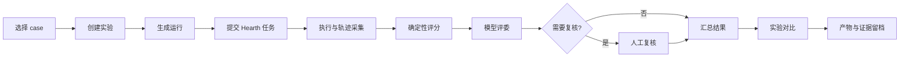

<p align="center">
  <picture>
    <source media="(prefers-color-scheme: dark)" srcset="docs/public/brand/hearth-os-logo-reverse.png">
    <source media="(prefers-color-scheme: light)" srcset="docs/public/brand/hearth-os-logo.png">
    
  </picture>
</p>

<p align="center">
  <strong>像实验室一样运行个人 Agent 评测。</strong><br>
  60 个真实任务 · 8 个任务族 · 30 个白盒场景 · 全周期可视化
</p>

<p align="center">
  <a href="https://hearthproject.github.io/hearth-eval/"><strong>文档站</strong></a> ·
  <a href="#最新结果">最新结果</a> ·
  <a href="#快速开始">快速开始</a> ·
  <a href="#评测全周期">评测全周期</a> ·
  <a href="#任务集">任务集</a> ·
  <a href="#架构">架构</a> ·
  <a href="#验证">验证</a>
</p>

<p align="center">
  
  
  
  
  
  
</p>

---

Hearth Eval Agent 不是一个散落着脚本的评测集，而是一个**独立于个人 Agent 运行时的评测控制面**。它管理任务目录、创建实验、驱动目标 Agent 执行、保存完整轨迹、运行确定性与模型评分、排队人工复核，并把两次实验放回同一张表里比较。

它回答一个很具体的问题：**同一批真实任务，在不同执行器、重复次数和运行模式下，通过率、质量分数、耗时、Token 和审批次数发生了什么变化？**

> **边界：** 本仓库负责“怎么评测”，不伪造评测结论。首次启动不会自动创建实验；真实通过率、执行器差异和成本数据必须由你实际运行后产生。

## 为什么单独拆出来

| 问题 | Hearth 主仓库 | Hearth Eval Agent |
|---|---|---|
| 关心什么 | 把用户意图变成可靠任务 | 证明任务完成得是否稳定、可信、值得成本 |
| 运行内容 | Agent、执行器、审批、记忆、调度 | Case、实验、评分、复核、对比、证据 |
| 失败语义 | 任务失败、等待输入或审批 | 实验失败、需要复核、不可比或样本不足 |
| 数据边界 | `.hearth/artifacts` 与个人状态 | `.hearth/eval` 与 `.hearth/eval-artifacts` |

拆分后，评测不会把实验状态混入个人 Agent 的正式产物，主服务只需要保留一个最小运行桥接。

## 能做什么

| 能力 | 当前实现 |
|---|---|
| **任务目录** | 60 个 case、8 个任务族；按任务族、难度、运行模式和关键词筛选 |
| **实验编排** | 多 case、多执行器、1–5 次重复、离线/在线模式、并发上限与取消 |
| **全周期轨迹** | 从任务创建、执行、等待审批到评分、复核、完成或失败的逐事件记录 |
| **三层评分** | 确定性检查、模型 rubric 评分、人工复核；blocker 失败直接归零 |
| **人工复核队列** | 低置信度、评委冲突、抽样复核与 `pass/fail/unknown` 决定 |
| **实验对比** | 对齐 case、执行器、重复次数与运行模式；不可比时明确警告 |
| **产物审计** | 受控预览运行产物、grader 证据、Token、耗时、重试与审批次数 |
| **白盒场景** | 30 个本地场景，覆盖审批、效果对账、崩溃恢复、记忆、本体、任务图等 |

## 最新结果

2026-11-11 至 11-12 使用 30 个离线 case（8 个任务族均匀分布）、仅 `native` 执行器、重复 1 次、自动评分与自动重试开启、并发 4：

| 指标 | 结果 |
|---|---:|
| 最好完整单轮 | **18/30 通过（60%）**，平均分 88.89，`EXP-20261111145332-7a95ea` |
| 累计定向确认 | **19/30** 个 case 曾达到 100 分；不是一次连续实验 |
| 最近完整单轮 | 12/30 通过（40%），平均分 73.33，`EXP-20261112003215-b1172b` |
| 最终修复提交 | `eb32ad5`，尚未做不中断的完整 30 题复测 |

最近完整实验受到 provider 慢响应、评分 JSON 截断和任务超时影响，且早于最后四个归一化修复；40% 不能直接等同于最终代码能力。完整报告见 [hearth-os 评测页](https://hearthproject.github.io/hearth-os/evaluation/) 和[本仓库结果页](https://hearthproject.github.io/hearth-eval/reference/results.html)。

## 界面

评测控制台包含 11 个页面、7 个主导航入口，默认地址为 `http://127.0.0.1:5174`：

- **总览**：运行中实验、待复核数量、任务目录健康度和最近活动；
- **任务目录 / 任务详情**：任务 manifest、输入、golden、评分标准和历史实验；
- **实验 / 新建实验 / 实验详情**：创建、启动、取消和查看完整生命周期；
- **运行详情**：轨迹、deterministic/judge 结果、产物预览和 Hearth 任务关联；
- **复核队列**：需要人判断的项目集中处理；
- **对比**：通过率、分数和任务族差异，附对齐条件；
- **活动流**：按实验、运行和事件类型查看控制面活动；
- **系统**：Hearth 连通性、执行器健康、评委模型和存储路径。

## 快速开始

推荐把两个仓库放在同一级目录：

```text
D:\App\
  hearth-os\
  hearth-eval\
```

### 1. 启动 Hearth 主服务

在 `hearth-os` 中启动个人 Agent，并允许评测服务读取本仓库的输入目录：

```powershell
# hearth-os\.env
HEARTH_EVAL_INPUT_ROOT=D:\App\hearth-eval\eval
```

```powershell
cd D:\App\hearth-os
npm install
npm run dev
```

主服务默认监听 `127.0.0.1:4317`。

### 2. 启动评测 Agent

```powershell
cd D:\App\hearth-eval
npm install
Copy-Item .env.example .env
$env:HEARTH_EVAL_ARTIFACT_ROOT='D:\App\hearth-os\.hearth\eval-artifacts'
npm run dev
```

打开 `http://127.0.0.1:5174`。评测服务监听 `127.0.0.1:4318`，Vite 会把 `/api` 代理到评测服务。

`HEARTH_EVAL_ARTIFACT_ROOT` 必须与主服务实际写入的产物根一致；遗漏时运行详情会找不到已登记产物，并错误报告 `BLOCKER_FAILED: exists`。重启评测服务后，先通过 `GET /api/system` 确认 `artifactRoot`，再开始实验。

### 3. 创建第一条实验

1. 在“任务目录”选择 case；
2. 在“实验”中勾选执行器与重复次数；
3. 点击创建并启动；
4. 在运行详情查看轨迹、评分与产物；
5. 在复核队列处理需要人判断的项目；
6. 用“对比”检查两次实验是否真的可比。

首次启动只校验目录、同步 case 版本并恢复中断运行，**不会自动执行任务**。

## 评测全周期



关键状态不会被平均分掩盖：

- `failed`：blocker 或执行失败；
- `needs_review`：评委不可用、置信度不足或命中抽样；
- `blocked`：依赖、审批或环境无法继续；
- `passed`：确定性、模型和人工标准在可用权重内全部满足。

## 任务集

| 任务族 | 数量 | 典型任务 |
|---|---:|---|
| `documents` | 9 | 会议纪要、合同提取、多报告摘要、课程教案 |
| `email` | 8 | 收件箱分流、回复草稿、投诉处理、发票与账单 |
| `calendar` | 7 | 日程规划、冲突处理、周视图、里程碑、隐私 |
| `web` | 8 | 网页归档、表格提取、来源追踪、安全审计 |
| `research` | 8 | 多源检索、证据链、事实核验、研究缺口 |
| `code` | 8 | Bug 修复、PR 评审、CI 复现、契约检查、升级 |
| `desktop` | 5 | 应用操作、恢复、边界与不可逆动作 |
| `cross-app` | 7 | 邮件、日历、文档、桌面之间的组合任务 |

每个 case 都有 `case.json`，声明目标、输入、期望产物、grader、评分标准和人工复核策略。目录名必须与 manifest `id` 一致；离线 case 必须提供 `golden/`。

## 架构

```text
┌──────────────────────────────┐
│ apps/eval-web                │
│ React + Vite · 11 个页面     │
└──────────────┬───────────────┘
               │ /api
┌──────────────▼───────────────┐       POST /api/eval/tasks       ┌──────────────────────┐
│ apps/eval-server             │ ───────────────────────────────▶ │ Hearth main service  │
│ Fastify · 实验 · 轨迹 · 评分 │ ◀─────────────────────────────── │ Agent runtime · 4317 │
└──────────────┬───────────────┘       GET  /api/tasks/:id        └──────────────────────┘
               │                         POST /api/eval/judge
       ┌───────▼────────┐
       │ SQLite + 产物  │
       │ .hearth/eval   │
       └────────────────┘

packages/eval-core   契约、目录加载、grader、评分、场景统计
eval/                60 个 case、输入、golden、历史验收证据
scenario-runner/     30 个 Hearth 白盒场景（读取同级 hearth-os）
docs/                VitePress 中文文档站
```

评测服务内部，`EvalRunner` 只依赖两个窄接口：`AgentAdapter`（任务创建、任务视图、产物、取消、健康检查）与 `JudgeAdapter`（按 runner 已取得的产物评分）。默认实现分别是 `HearthClient` 与 `HearthJudgeAdapter`；前者按 `HEARTH_EVAL_ARTIFACT_ROOT` 解析产物，后者转调 `/api/eval/judge`。新增 Agent 后端只需实现 adapter，不复制实验编排、SQLite、复核或控制台。

评测服务通过两个专用接口访问 Hearth：

- `POST /api/eval/tasks`：受控创建评测任务；
- `POST /api/eval/judge`：使用已登记产物做模型评分。

输入文件只允许位于 `HEARTH_EVAL_INPUT_ROOT` 下；输出只允许写入 `.hearth/eval-artifacts/`；离线实验拒绝 URL 输入；外部写入必须经过 Hearth 原有审批。

## 评分模型

每个 case 的 criteria 分为三类：

| 来源 | 用途 | 默认权重 |
|---|---|---:|
| `deterministic` | 文件存在、内容包含、JSON/CSV 结构、数量和 golden 对比 | 60 |
| `judge` | 模型按 rubric 判断质量、完整性、证据与表达 | 30 |
| `human` | 人确认低置信度、冲突或抽样项目 | 10 |

通过阈值为 **80 分**。分数按当前可用权重归一化；任一 blocker 失败直接得到 0 分和 `failed`。模型评委不可用时，需要 judge 的运行进入 `needs_review`，不会静默通过。

## 常用命令

```bash
npm run dev                 # 评测服务 + 控制台
npm run dev:server          # 仅评测服务，4318
npm run dev:web             # 仅控制台，5174
npm test                    # 单元与 API 测试
npm run typecheck           # 评测代码类型检查
npm run typecheck:scenarios # 白盒场景类型检查
npm run eval:scenarios      # 30 个本地场景，每个重复 3 次
npm run build               # 构建评测控制台
npm start                   # 生产启动，服务端托管 dist
npm run check               # 类型检查 + 测试 + 构建
npm run docs:dev            # 文档站开发
npm run docs:build          # 构建文档站
```

只复现一个场景：

```bash
npm run eval:scenarios -- --only approval-rejected-stops,unknown-effect-reconcile
```

场景读取同级 `../hearth-os` 的白盒服务；运行结果写入 `eval/scenario-runs/`，该目录不纳入版本控制。

## 📁 目录结构

```text
hearth-eval/
├── apps/                                             # 评测应用入口
│   ├── eval-server/                                  # 评测控制面（Fastify + SQLite）
│   │   ├── src/                                      # 15 个文件；实现与同名 *.test.ts 并列
│   │   │   ├── index.ts / app.ts                     # 服务入口与实验 / 判分 / 复核 REST + SSE
│   │   │   ├── runner.ts                             # **实验编排**：并发、超时、重试、全周期轨迹
│   │   │   ├── store.ts                              # 实验、运行、评分与复核持久化
│   │   │   ├── hearth-client.ts                      # 调用 hearth-os 的 /api/eval/* 桥接
│   │   │   ├── agent-adapter.ts / judge-adapter.ts   # 执行器启动与自动判分
│   │   │   ├── artifact-path.ts / config.ts          # 受管产物路径防护与环境配置
│   │   │   └── *.test.ts                             # 服务层契约与失败路径测试
│   │   └── package.json                              # @hearth/eval-server
│   ├── eval-web/                                     # React + Vite 可视化控制台
│   │   ├── src/pages/                                # 11 页：Dashboard / Cases / Experiments / Runs / Compare …
│   │   ├── src/components/                           # AppShell.tsx 与 ui.tsx
│   │   ├── src/lib/                                  # api.ts 与 labels.ts
│   │   ├── src/App.tsx / main.tsx / styles.css       # 路由入口与样式
│   │   └── index.html / vite.config.ts               # SPA 入口与构建配置
├── packages/eval-core/                               # **Case 契约、目录加载与评分类库**
│   ├── src/                                          # 13 个文件：schema / types / node / api / graders / scoring / scenarios
│   └── package.json                                  # @hearth/eval-core
├── eval/                                             # **任务集与证据，评测的事实来源**
│   ├── cases/                                        # 60 个 case 目录，8 个任务族
│   │   └── CAL01/ …                                  # case.json + input.json 或固定输入，多数含 golden/
│   ├── inputs/                                       # 19 份固定输入文本（覆盖 T01–T15）
│   ├── runs/                                         # 15 个任务的验收产物与 run-manifest.json
│   ├── scenarios/scenarios.json                      # 30 个白盒场景 manifest（P0 / P1 / P2 / PA）
│   ├── phase-1-acceptance.md                         # 第一阶段 15 项任务验收报告
│   ├── mvp-task-catalog.md / README.md               # 任务集清单与评分口径 / 目录说明
│   └── template-acceptance.ts                        # 验收脚本模板
├── scenario-runner/                                  # 白盒集成场景运行器（读取同级 ../hearth-os 源码）
│   ├── run-scenarios.ts / registry.ts                # 场景入口与注册表
│   ├── p0-*.ts                                       # 动作、边界、效果、敏感信息四组场景
│   ├── p1-*.ts / p2-connection.ts                    # 记忆技能、主动、定时与连接场景
│   ├── pa-scenarios.ts / support.ts                  # 个人 Agent 场景与公共夹具
│   ├── common.ts / types.ts / tsconfig.json          # 类型、辅助与独立类型检查
│   └── README.md                                     # 运行说明
├── docs/                                             # VitePress 中文文档站（push main 自动发布 Pages）
│   ├── guide/                                        # 上手、架构、全周期、评分与任务清单
│   ├── reference/                                    # API、case schema、场景、结果与旧 MVP
│   ├── public/                                       # logo.svg 与 brand/ 品牌资源
│   ├── .vitepress/config.mts                         # 站点导航与侧栏
│   └── index.md                                      # 文档站首页
├── .github/workflows/                                # ci.yml 类型/测试/构建 · docs.yml Pages 发布
├── package.json / package-lock.json                  # workspaces 与 test / eval:scenarios / docs 脚本
├── tsconfig*.json / vitest.config.ts                 # 类型检查与 Vitest
├── .env.example / .editorconfig                      # 环境变量样例与编辑器约定
└── README.md / LICENSE                               # 中文主文档与 Apache-2.0
```

## 验证

2026-11-12 在当前分支运行：

```bash
npm test                    # 11 个测试文件、42 个测试全部通过
npm run typecheck
npm run typecheck:scenarios # 已补 turndown-plugin-gfm 模块声明
npm run build
npm run docs:build
```

本仓库的自动验证不会执行真实评测实验，也不会把任何实验标记为通过。测试与本地场景只能证明控制面、评分逻辑和故障边界；真实通过率、执行器差异、模型成本和人工耗时必须由你实际运行后产生。native 30 题的真实实验已经运行，但最终提交 `eb32ad5` 尚未连续复测，报告中的累计数字不能替代一次完整实验。

## 安全与数据边界

| 路径 | 内容 |
|---|---|
| `.hearth/eval/eval.sqlite` | case 版本、实验、运行、grader、复核与事件 |
| `.hearth/eval-artifacts/<experiment>/<case>/<executor>/r<n>` | 单次运行产物与证据 |
| `eval/cases/<caseId>/` | 输入、manifest、golden 与可选 live 输入 |
| `eval/scenario-runs/<timestamp>/` | 本地场景报告，已忽略 |

评测服务不接受任意本地输入路径，不写仓库外目录，不把评测产物混入个人 Agent 的正式产物。服务恢复时会把中断运行标记为需要处理，而不是当作通过。

## 许可

Apache-2.0。见 [LICENSE](LICENSE)。
