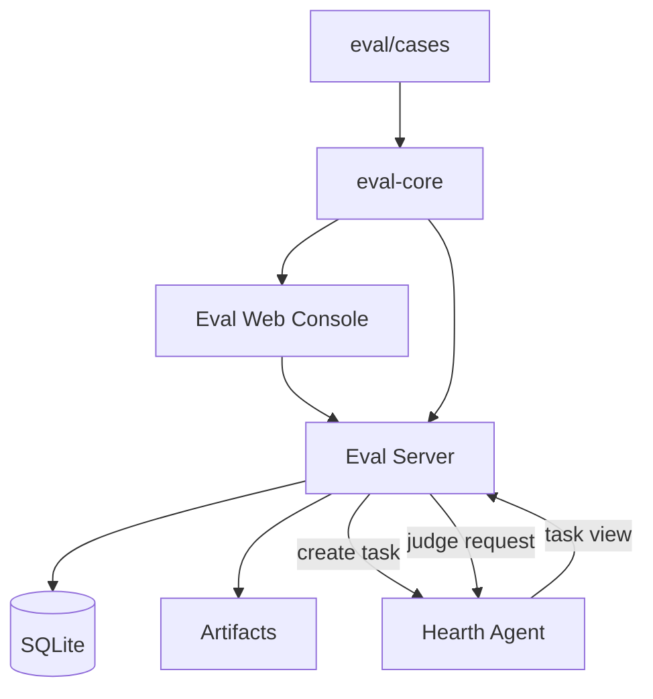

# 系统架构

## 职责划分



| 模块 | 职责 |
|---|---|
| `apps/eval-web` | 控制台、实验创建、轨迹、复核、对比与系统状态 |
| `apps/eval-server` | 生命周期编排、SQLite、Hearth 客户端、评分与产物托管 |
| `packages/eval-core` | API 契约、case schema、grader、评分与场景统计 |
| `eval/cases` | 任务事实来源：输入、manifest 与 golden |
| `scenario-runner` | 读取同级 Hearth 源码的白盒集成场景 |

## 两个运行仓库

评测 Agent 不复制 Hearth 的运行时。它把任务交给 Hearth，然后读取任务视图并保存评测侧证据。

```text
Hearth: 意图 → 任务 → 执行 → 审批 → 产物
Eval:   case → run → 等待任务 → 评分 → 复核 → 实验汇总
```

评测服务通过两个专用接口访问 Hearth：

- `POST /api/eval/tasks`
- `POST /api/eval/judge`

普通任务查看、取消和健康检查仍使用 Hearth 现有 API。

## 数据边界

| 路径 | 所属 |
|---|---|
| `hearth-os/.hearth/artifacts` | 个人 Agent 正式产物 |
| `hearth-os/.hearth/eval-artifacts` | 评测运行产物 |
| `hearth-eval/.hearth/eval` | 评测 SQLite |
| `hearth-eval/eval/cases` | 任务与输入 |
| `hearth-eval/eval/scenario-runs` | 本地场景证据，已忽略 |

评测输入只从 `HEARTH_EVAL_INPUT_ROOT` 读取；输出只写 `.hearth/eval-artifacts/`；离线模式禁用 URL 输入和网络。

## 安全原则

1. 不接受任意本地路径；
2. 不把评测产物混入正式任务产物；
3. 不跳过 Hearth 的审批、沙箱和权限模型；
4. 模型评委不可用时进入人工复核，不伪造通过；
5. 重启恢复只标记未完成运行，不重放未知外部副作用。
