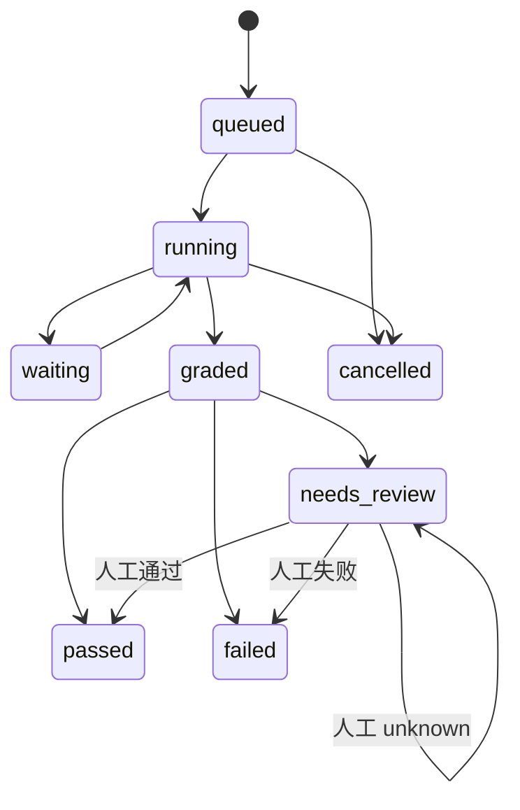

# 评测全周期

## 状态流转



## 创建实验

实验配置保存 case 集合、executor 集合、重复次数、运行模式、并发、自动评委、自动重试和 baseline。创建实验时只生成运行记录，不修改 case 事实。

## 生成运行

每个运行有稳定的 `externalRef`：

```text
eval:<experiment>:<case>:<executor>:r<repetition>
```

重复提交同一请求时幂等返回原 Hearth 任务；请求内容变化时返回冲突，避免同一运行被执行两次。

## 执行与轨迹

评测服务轮询 Hearth 任务状态，记录：

- 任务创建与 Hearth task ID；
- 运行中、等待输入或等待审批；
- 每次 attempt、Token 与耗时；
- 审批次数和重试次数；
- 最终产物和失败原因。

任务进入 `waiting_approval` 时，运行保持等待而不是自动批准。

## 评分

任务结束后先运行确定性 grader，再按 case 配置调用 judge，最后计算 blocker、分数和复核触发条件。详细规则见[评分与复核](/guide/scoring)。

## 人工复核

复核决定为 `pass`、`fail` 或 `unknown`：

- `pass`、`fail` 会重新计算运行状态并清除复核触发；
- `unknown` 保留待复核状态；
- 记录 reviewer、分数、备注和更新时间。

## 对比

对比同时检查：

- 运行模式是否一致；
- 重复次数是否一致；
- executor 集合是否一致；
- case 集合是否一致；
- 任务族差异是否被总体平均分掩盖。

不满足对齐条件时返回 `aligned: false` 和明确警告。
