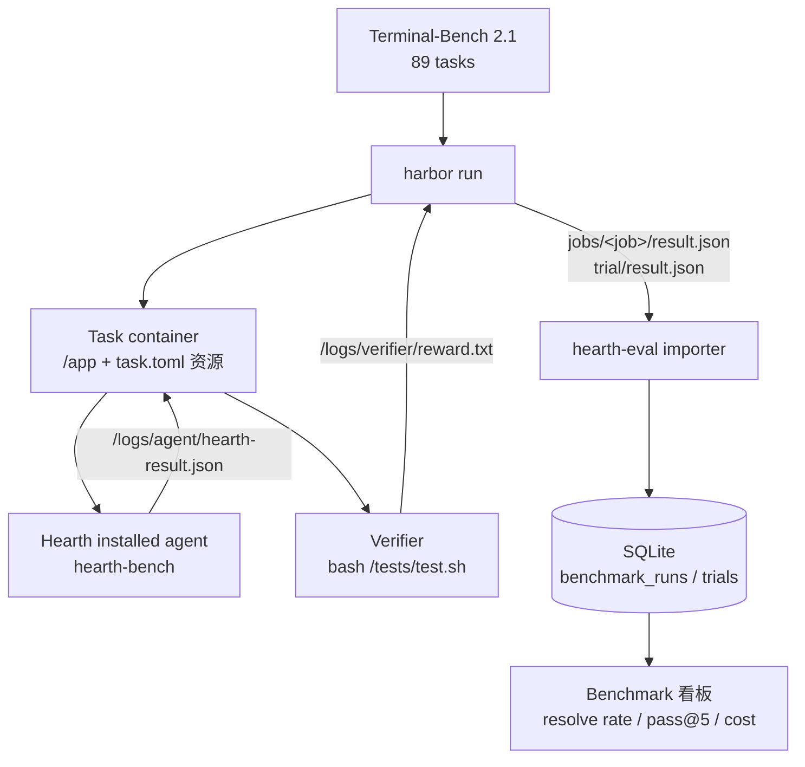

# Terminal-Bench 2.1 接入执行计划

> 版本：v1 · 2026-11-20
> 目标仓库：`D:\App\hearth-eval`（评测控制面）、`D:\App\hearth-os`（被测 native harness）
> 一句话：**Harbor 负责跑，Hearth 负责答，hearth-eval 负责记。** 不在 hearth-eval 里重写容器执行器。

## 0. 一页结论

- Terminal-Bench 2.1 是 **89 道 Linux 容器任务**，官方执行框架是 **Harbor**；每题由 `tests/test.sh` 产出 `/logs/verifier/reward.txt`，取值 0/1。
- 被测对象是 Hearth 的 **native harness**：`shell`、文件读写、`apply_patch`、搜索、`run_tests`、上下文管理、token 预算。不是 Hearth 的 UI、审批或记忆产品功能。
- Hearth 以 **Harbor installed agent** 的方式进入任务容器：在 `/app` 里跑，和 verifier 共享同一个文件系统。
- hearth-eval **只做导入和记账**：读 Harbor 的 `jobs/<job>/` 结果，写 `benchmark_runs` / `benchmark_trials`，出 resolve rate、pass@5、token、成本、对比。
- 现有 50 个自定义 case 的 60/30/10 评分体系**完全不动**；benchmark 是平行域。
- 先本机 1 题 → 5 题 → 89 题 ×1；89 题 ×5 再上 Linux 云主机（32C/64G/200GB）。

## 1. 角色与边界

| 组件 | 负责 | 不负责 |
|---|---|---|
| Terminal-Bench 2.1 | 任务、instruction、镜像、`tests/test.sh`、时间限制 | 模型调用、harness 实现 |
| Harbor | 拉数据集、建容器、装 agent、跑 agent、跑 verifier、写 `jobs/<job>/`、并发、重试 | 评测历史、跨 run 对比、业务看板 |
| Hearth OS | 在容器内执行任务、产生 patch/命令/文件、输出 usage | 数据集管理、结果入库 |
| hearth-eval | 数据集/版本登记、导入 job、trial 明细、指标、对比、回归、看板 | 容器生命周期、镜像构建、verifier 执行 |

明确不做：

1. 不在 hearth-eval 里实现 Docker 编排；Harbor 已经是官方执行层，重复实现会持续追 TB 格式。
2. 不把 89 题塞进现有 `CaseManifest`。现有 `experiments` / `experiment_runs` 是 rubric 评分，TB 是二值 reward，语义不同。
3. 不对 TB trial 调 LLM judge。reward 只认 `reward.txt` / `reward.json`。
4. 不跨版本比较分数。TB 2.0 和 2.1 有 28/89 道题被修正，分数不可直接比。

## 2. 全链路



执行顺序：

1. 固定数据集版本：`terminal-bench/terminal-bench-2-1`，89 题。
2. Harbor 按 `task.toml` 拉镜像/建容器，设置 `cpus`、`memory_mb`、`storage_mb`、`allow_internet`。
3. Harbor 安装 Hearth agent：把 `hearth-bench` 放进容器，写入 instruction。
4. Hearth 在 `/app` 里执行任务；每轮工具调用、token、耗时写入 `/logs/agent/hearth-result.json`。
5. Hearth 退出后，Harbor 在容器里跑 `bash /tests/test.sh`，读 `/logs/verifier/reward.txt`。
6. Harbor 把整场 job 写到 `jobs/<job>/`：`result.json`、每个 trial 的 `result.json`、`verifier/`、`agent/`。
7. hearth-eval 离线导入这个目录；原始目录只读，导入幂等。
8. 看板按 dataset/version/harness/model 聚合；对比 run 时固定模型，只换 harness 版本。

## 3. 指标口径

| 指标 | 定义 | 用途 |
|---|---|---|
| `reward` | 每题 0/1 | 唯一事实来源 |
| `mean_reward` | `sum(reward) / valid_trials` | 与 TB 官方 5 次均值口径对齐 |
| `pass@1` | 单次尝试的 mean_reward | 单跑参考 |
| `pass@5` | 5 次中至少 1 次成功的题目比例 | 辅助指标，不替代 mean_reward |
| `valid_trials` | 排除基础设施失败的 trial 数 | 分母；infra 失败单独报告 |
| `tokens` | `n_input_tokens + n_output_tokens` | 成本与上下文效率 |
| `cost` | 按模型单价折算；缓存 token 单独计价 | `$/solved` |
| `duration` | trial 墙钟时间 | 与官方 timing 对齐 |

规则：

- `reward.txt` 缺失不能当成 0；标记 `error`，并排除出 `valid_trials`，同时单独统计 `infra_errors`。
- 超时、OOM、镜像拉取失败属于基础设施问题，不算模型答错。
- 95% 置信区间用 Wilson interval；不要只报一个单次分数。
- 报告必须带：数据集版本、Harbor 版本、Hearth commit、模型名、provider、并发数、超时、重试次数。

## 4. hearth-eval 仓库改造

### 4.1 设计原则

1. **平行域**：新增 benchmark 表，不复用 `experiments` 的 60/30/10。
2. **只读导入**：Harbor 的 `jobs/` 是事实来源；导入失败不触发重跑。
3. **原始不可变**：`jobs/` 原样保留；数据库只存索引和摘要，必要时可重建。
4. **幂等**：同一 job 重复导入不产生重复 trial。
5. **锁版本**：dataset、Harbor、Hearth、模型都记录版本/哈希。
6. **不做 LLM judge**：reward 只来自 verifier。

### 4.2 数据模型

建议新增四张表：

```sql
CREATE TABLE IF NOT EXISTS benchmark_datasets (
  id TEXT PRIMARY KEY,
  name TEXT NOT NULL,
  version TEXT NOT NULL,
  source TEXT NOT NULL,
  commit_sha TEXT,
  digest TEXT,
  task_count INTEGER NOT NULL,
  created_at TEXT NOT NULL
);

CREATE TABLE IF NOT EXISTS benchmark_tasks (
  id TEXT PRIMARY KEY,
  dataset_id TEXT NOT NULL,
  task_key TEXT NOT NULL,
  instruction_path TEXT,
  image_ref TEXT,
  timeout_sec REAL,
  metadata_json TEXT NOT NULL,
  UNIQUE(dataset_id, task_key)
);

CREATE TABLE IF NOT EXISTS benchmark_runs (
  id TEXT PRIMARY KEY,
  dataset_id TEXT NOT NULL,
  job_id TEXT NOT NULL UNIQUE,
  harness_name TEXT NOT NULL,
  harness_version TEXT NOT NULL,
  model TEXT NOT NULL,
  status TEXT NOT NULL,
  started_at TEXT,
  ended_at TEXT,
  config_json TEXT NOT NULL,
  raw_dir TEXT NOT NULL,
  created_at TEXT NOT NULL
);

CREATE TABLE IF NOT EXISTS benchmark_trials (
  id TEXT PRIMARY KEY,
  run_id TEXT NOT NULL,
  task_id TEXT NOT NULL,
  trial_key TEXT NOT NULL,
  attempt INTEGER NOT NULL DEFAULT 1,
  reward REAL,
  status TEXT NOT NULL,
  duration_ms INTEGER,
  input_tokens INTEGER,
  output_tokens INTEGER,
  cached_tokens INTEGER,
  cost_usd REAL,
  reward_path TEXT,
  result_path TEXT,
  error_code TEXT,
  error_message TEXT,
  raw_json TEXT,
  UNIQUE(run_id, trial_key)
);

CREATE INDEX IF NOT EXISTS benchmark_trials_run_idx
  ON benchmark_trials(run_id, task_id);
```

`status` 取值：`passed`、`failed`、`error`、`timeout`、`budget_exceeded`、`skipped`。

### 4.3 新增文件

| 文件 | 作用 |
|---|---|
| `packages/eval-core/src/benchmark.ts` | benchmark 类型、指标计算、Wilson CI、CSV 行类型 |
| `apps/eval-server/src/benchmark-store.ts` | 四张表的建表、读写、幂等 upsert |
| `apps/eval-server/src/benchmark-import.ts` | 解析 `jobs/<job>/`，校验 schema，写 trial |
| `apps/eval-server/src/benchmark-routes.ts` | `/api/benchmarks/*` 路由 |
| `apps/eval-server/src/benchmark-import-cli.ts` | `npm run bench:import -- --job ...` |
| `apps/eval-server/src/config.ts` | 增加 `harborJobsRoot` 配置 |
| `apps/eval-server/src/app.ts` | 注册 benchmark 路由 |
| `apps/eval-web/src/pages/BenchmarksPage.tsx` | run 列表 |
| `apps/eval-web/src/pages/BenchmarkDetailPage.tsx` | 89 题网格、trial 抽屉、指标卡 |
| `apps/eval-web/src/components/BenchmarkComparePanel.tsx` | 两个 run 的逐题对比 |
| `apps/eval-web/src/App.tsx` | 增加 `/benchmarks`、`/benchmarks/:id` 路由 |
| `package.json` | 增加 `bench:import` 脚本 |
| `docs/.vitepress/config.mts` | 侧边栏增加本页 |
| `apps/eval-server/src/benchmark-import.test.ts` | 导入 fixture、幂等、缺 reward、schema 漂移 |
| `apps/eval-server/src/benchmark-metrics.test.ts` | mean_reward、pass@5、CI、成本 |
| `apps/eval-server/test/fixtures/harbor-job-mini/` | 3 个 trial：pass / fail / error |

不放的东西：

- 不放 Docker SDK、容器编排、镜像构建。
- 不放 TB 任务数据；运行时从 Harbor 数据集缓存。
- 不放 LLM judge。

### 4.4 导入契约

Harbor 的 job 目录结构（官方文档）：

```text
jobs/<job-name>/
├── config.json
├── result.json
├── <trial-name>/
│   ├── config.json
│   ├── result.json
│   ├── agent/
│   │   ├── recording.cast
│   │   └── trajectory.json
│   └── verifier/
│       ├── ctrf.json
│       ├── reward.txt
│       ├── test-stderr.txt
│       └── test-stdout.txt
└── ...
```

解析优先级：

| 字段 | 首选 | 兜底 | 失败处理 |
|---|---|---|---|
| task_key | trial `config.json` 的 `task_name` | trial 目录名 | 该 trial `error` |
| reward | `verifier/reward.txt` | trial `result.json.reward` | 缺两者 → `error`，不记 0 |
| input tokens | trial `result.json.n_input_tokens` | `agent/hearth-result.json.usage.inputTokens` | 允许 `null` |
| output tokens | trial `result.json.n_output_tokens` | `agent/hearth-result.json.usage.outputTokens` | 允许 `null` |
| cached tokens | Hearth result | — | 允许 `null` |
| duration | trial `result.json` 时间戳 | `config.json` 时间戳 | 允许 `null` |
| model | job `config.json` | 导入参数 | 缺失则拒绝导入 |
| harness | job `config.json.agent` | 导入参数 | 缺失则拒绝导入 |

导入 API：

```http
POST /api/benchmarks/import
Content-Type: application/json

{
  "jobDir": "D:\\App\\harbor-jobs\\tb21-hearth-001",
  "dataset": "terminal-bench/terminal-bench-2-1",
  "datasetVersion": "sha256:7d7bdc1cbedad549fc1140404bd4dc45e5fd0ea7c4186773687d177ad3a0699a",
  "harness": "hearth-native",
  "harnessVersion": "0.1.0+git.<sha>",
  "model": "openai/<model>",
  "dryRun": false
}
```

校验：

- `jobDir` 必须位于 `harborJobsRoot` 下，拒绝 `..` 和符号链接。
- `result.json` 必须存在；job `config.json` 必须能解析。
- 同一 `job_id` 重复导入返回 `replayed: true`，trial 数量不增加。
- schema 不认识时返回 `IMPORT_SCHEMA_MISMATCH`，保留原始目录，不猜字段。
- `dryRun: true` 只返回将导入/跳过的数量。

### 4.5 路由

| 方法 | 路径 | 用途 |
|---|---|---|
| `POST` | `/api/benchmarks/import` | 导入 Harbor job 目录 |
| `GET` | `/api/benchmarks` | 分页列出 run |
| `GET` | `/api/benchmarks/:id` | run 详情、指标、trial 摘要 |
| `GET` | `/api/benchmarks/:id/trials` | trial 分页/筛选 |
| `GET` | `/api/benchmarks/:id/compare?baseline=<runId>` | 与 baseline 逐题对比 |
| `GET` | `/api/benchmarks/:id/export?format=csv` | 导出逐题 CSV |
| `POST` | `/api/benchmarks/:id/reimport` | 幂等重放导入 |

暂不做 `POST /api/benchmarks/launch`。如果以后要做，只允许用 `child_process` 调 `harbor run` 子进程，不引入 Docker SDK；失败不自动重跑模型 trial。

### 4.6 看板

列表页：

- dataset/version、harness/version、model、日期、`mean_reward`、95% CI、tokens、`$/solved`。
- 筛选：dataset、harness、model、status。

详情页：

- 89 题网格：绿=1、红=0、灰=error、黄=timeout。
- 顶部指标卡：`mean_reward`、`pass@5`、`resolved/total`、`infra_errors`、总 token、总成本、平均耗时。
- trial 抽屉：instruction、reward、verifier stdout/stderr、`hearth-result.json`、token、duration、失败原因。
- 不展示模型自评分数。

对比页：

- 固定同一 dataset、同一模型，只换 harness 版本。
- 逐题 diff：win/loss/tie、reward 变化、token 变化、耗时变化。
- 汇总：`mean_reward` 差、CI 是否重叠、`$/solved` 变化。

### 4.7 测试与验收

单元测试 fixture：

1. 正常 3 trial：1 pass、1 fail、1 error，指标可手算。
2. 缺 `reward.txt`：必须 `error`，不是 0。
3. 重复导入：trial 数不变，`replayed=true`。
4. schema 漂移：抛 `IMPORT_SCHEMA_MISMATCH`，不写半截数据。
5. `jobDir` 路径穿越：拒绝。

验收命令：

```powershell
cd D:\App\hearth-eval
npm run typecheck
npm test
npm run build
npm run docs:build
```

验收标准：

- [ ] 导入 5 题 job，详情页显示 5 个 trial，指标与手算一致。
- [ ] 同一 job 导入两次，数据库仍是 5 条。
- [ ] 缺 reward 的 trial 显示 `error`，不被算成 fail。
- [ ] 现有 50 个自定义 case 的测试全部通过。
- [ ] `jobs/` 原始目录未被修改。

### 4.8 实施顺序

| 阶段 | 内容 | 估时 |
|---|---|---|
| 0 | 本页文档 + 3-trial fixture | 0.5 天 |
| 1 | 数据模型 + store + 导入器 | 2 天 |
| 2 | 导入/查询/对比 API | 1 天 |
| 3 | 列表/详情看板 | 1.5 天 |
| 4 | 对比、CSV、回归门禁 | 1 天 |
| 5 | 5 题真实 job 联调 | 1 天 |

总计约 **6 个工作日**，不包含 Hearth 的 Linux 单文件产物（见第 5 节）。

## 5. Hearth OS 需要补的能力

Hearth 已经有 `shell`、`read/write/edit/apply_patch`、`grep/glob`、`run_tests`、`todo`、usage 统计，以及 `scripts/bench/run-agent.ts` 单任务无头入口。要补的是“能在 TB 容器里跑”和“benchmark 模式”。

| 文件 | 改动 |
|---|---|
| `scripts/bench/run-agent.ts` | 增加 `--benchmark`、`--json-out`、`--max-duration`、`--max-tokens`；输出稳定 JSON |
| `packages/agent-runtime/src/harness/profiles.ts` | 新增 `BENCH_RUN_BUDGET`：3 小时、200 turns、100 万 token/题 |
| `packages/agent-runtime/src/tools.ts` | `createBuiltinTools({ profile: "bench" })`：只留 shell/file/search/patch/test/todo/finish |
| `packages/agent-runtime/src/harness/environment.ts` | `HEARTH_IN_CONTAINER=1` 时强制 bash，不走 PowerShell |
| `packages/agent-runtime/src/harness/sandbox.ts` | 容器即沙箱：允许 no-sandbox，宿主机模式仍保留 ACL |
| `packages/agent-runtime/src/harness/prompt.ts` | benchmark 用原始 instruction，不拼 outDir/expectedOutputs |
| `scripts/build-bench.mjs` | esbuild bundle + Node SEA，产出 `hearth-bench-linux-x64` |
| `integrations/harbor/hearth_agent.py` | Harbor installed agent adapter |
| `integrations/harbor/install-hearth.sh.j2` | 在容器里安装/校验 `hearth-bench` 的脚本 |

benchmark profile 必须关掉：

- `ask_user`（等人回答会挂死）
- `capture_screen`、桌面类工具
- memory / skills / user profile 注入
- 持久 `.hearth` 状态；每次 trial 用 `/tmp/hearth`

benchmark profile 必须打开：

- `/app` 读写，`/tmp` 读写，`/` 可读
- shell 走容器内 bash
- 网络按 `task.toml` 的 `[agent]` 策略
- `HEARTH_IN_CONTAINER=1` 才允许 no-sandbox

Hearth 输出契约：

```json
{
  "status": "completed",
  "usage": {
    "inputTokens": 123456,
    "cachedInputTokens": 45678,
    "outputTokens": 6789
  },
  "turns": 42,
  "toolCalls": 87,
  "summary": "Implemented X and verified with tests."
}
```

`status` 允许：`completed`、`failed`、`timeout`、`budget_exceeded`。

Harbor adapter 示意：

```python
from pathlib import Path
from harbor.agents.installed.base import BaseInstalledAgent, ExecInput

class HearthAgent(BaseInstalledAgent):
    @staticmethod
    def name() -> str:
        return "hearth-native"

    @property
    def _install_agent_template_path(self) -> Path:
        return Path(__file__).with_name("install-hearth.sh.j2")

    def create_run_agent_commands(self, instruction: str) -> list[ExecInput]:
        return [ExecInput(
            command=(
                "hearth-bench --benchmark "
                "--goal-file /tmp/hearth/instruction.md "
                "--workspace /app "
                "--json-out /logs/agent/hearth-result.json"
            ),
            env={
                "HEARTH_IN_CONTAINER": "1",
                "HEARTH_HOME": "/tmp/hearth",
                "HEARTH_MODEL_BASE_URL": "<Harbor 允许的模型地址>",
                "HEARTH_MODEL_API_KEY": "<运行时注入，不写进镜像>",
                "HEARTH_MODEL_NAME": "<model>",
            },
            timeout_sec=1800,
        )]
```

> 以上是接口示意；以当前 Harbor 版本的 `BaseInstalledAgent` 签名为准。不要把 API Key 打进镜像或 git。

## 6. 本机跑 TB 2.1（Windows）

### 6.1 本机能力边界

| 项 | 要求 | 本机现状 |
|---|---|---|
| 系统 | Windows 10/11 + WSL2 | Windows，Docker Desktop 已安装但 daemon 未启动 |
| Docker | Linux containers | 需启动 Docker Desktop |
| 内存 | 16GB 起；单题建议 10GB 给 Docker | 15.2GB，可跑 1 题 |
| 磁盘 | 5–10 题 60GB；89×5 200GB | D 盘 38.3GB，只够冒烟 |
| Node | ≥ 22.13 | 需确认 |
| Python/uv | Harbor 需要 Python 3.11+ | 需安装 uv |

结论：**本机可以一题一题跑，不适合 89×5 全量。**

### 6.2 安装 Docker + Harbor

1. 安装/启动 Docker Desktop，启用 WSL2。
2. 验证：

```powershell
docker version
docker run --rm hello-world
```

3. 给 WSL2 分配资源，编辑 `C:\Users\<你>\.wslconfig`：

```ini
[wsl2]
memory=10GB
processors=6
swap=2GB
```

然后：

```powershell
wsl --shutdown
```

4. 安装 uv 和 Harbor：

```powershell
winget install astral-sh.uv
uv tool install harbor
harbor --help
```

如果 PATH 里没有 `harbor`，重开终端，或把 `%USERPROFILE%\.local\bin` 加入 PATH。

5. 确认数据集：

```powershell
harbor dataset list
```

### 6.3 第一题：先跑 Oracle

Oracle 用任务的 `solution/solve.sh`，不需要模型；它验证镜像、测试脚本、reward 链路。

```powershell
harbor run `
  -d terminal-bench/terminal-bench-2-1 `
  -t terminal-bench/headless-terminal `
  -a oracle `
  -n 1
```

> `-t` 的任务 key 以 `harbor dataset list` / 数据集实际列表为准；`headless-terminal` 是示例。

跑完检查：

```powershell
Get-ChildItem jobs -Recurse -Filter result.json
Get-ChildItem jobs -Recurse -Filter reward.txt
```

预期：某个 trial 的 `verifier/reward.txt` 是 `1`。

### 6.4 第二题：跑 Hearth

1. 先有 `hearth-bench-linux-x64`。构建方式见第 5 节；没有产物时先跳过这步。
2. 把 `integrations/harbor/hearth_agent.py` 和 `install-hearth.sh.j2` 放到 `D:\App\harbor-agents`，并设置 `PYTHONPATH`。
3. 本机调试时，用 HTTP 把二进制暴露给容器：

```powershell
cd D:\App\hearth-os\dist
python -m http.server 8765
```

`install-hearth.sh.j2` 里用：

```bash
curl -fsSL "http://host.docker.internal:8765/hearth-bench-linux-x64" \
  -o /usr/local/bin/hearth-bench
chmod +x /usr/local/bin/hearth-bench
```

4. 跑单题：

```powershell
$env:PYTHONPATH = "D:\App\harbor-agents"
harbor run `
  -d terminal-bench/terminal-bench-2-1 `
  -t terminal-bench/headless-terminal `
  --agent-import-path hearth_agent:HearthAgent `
  -m "openai/<your-model>" `
  -n 1
```

5. 检查：

```powershell
Get-Content jobs\<job>\<trial>\verifier\reward.txt
Get-Content jobs\<job>\<trial>\agent\hearth-result.json
Get-Content jobs\<job>\result.json
```

验收清单：

- [ ] 容器能启动，Hearth 能装进去。
- [ ] `/app` 是任务工作目录。
- [ ] Hearth 能执行 shell、读写文件、跑测试。
- [ ] 不弹 `ask_user`、不等审批。
- [ ] `hearth-result.json` 有 `status` 和 `usage`。
- [ ] `reward.txt` 是 0/1。
- [ ] 退出后没有残留容器：`docker ps -a`。

### 6.5 5 题

两种做法：

1. 逐题 `-t`，跑 5 次；适合调试。
2. 做一个 5 题本地数据集目录，用 `-p`：

```powershell
harbor run `
  -p "D:\App\tb21-mini\tasks" `
  --agent-import-path hearth_agent:HearthAgent `
  -m "openai/<your-model>" `
  -n 2
```

记录每题耗时和 token，估算全量：

```text
89 题 ×1 ≈ 5 题总耗时 × 17.8
89 题 ×5 ≈ 上述 ×5
```

如果 5 题平均超过 30 分钟，89×5 本机串行约 9 天，直接上云。

### 6.6 89 题

本机串行、低并发：

```powershell
harbor run `
  -d terminal-bench/terminal-bench-2-1 `
  --agent-import-path hearth_agent:HearthAgent `
  -m "openai/<your-model>" `
  -n 2
```

云主机：

```bash
harbor run \
  -d terminal-bench/terminal-bench-2-1 \
  --agent-import-path hearth_agent:HearthAgent \
  -m "openai/<model>" \
  -n 16
```

### 6.7 导入 hearth-eval

```powershell
cd D:\App\hearth-eval
npm run bench:import -- `
  --job "D:\App\harbor-jobs\tb21-hearth-001" `
  --dataset terminal-bench/terminal-bench-2-1 `
  --harness hearth-native `
  --model "openai/<model>"
```

然后打开：

```text
http://127.0.0.1:5175/benchmarks
```

### 6.8 本机常见问题

| 现象 | 原因 | 处理 |
|---|---|---|
| `docker: daemon not running` | Docker Desktop 未启动 | 启动 Docker Desktop，等鲸鱼图标稳定 |
| `harbor: command not found` | uv 工具目录不在 PATH | 重开终端，加入 `%USERPROFILE%\.local\bin` |
| 拉镜像 401/超时 | Docker Hub 网络/限流 | 配镜像加速，或换香港/新加坡网络 |
| `reward.txt` 不存在 | `tests/test.sh` 没写 reward | 看 `verifier/test-stderr.txt`，不要当 0 分 |
| Hearth 停住不动 | 触发了 `ask_user` 或审批 | bench profile 去掉 `ask_user` 和审批 |
| 容器 OOM | WSL 内存太小 / 题太重 | 降并发；把 WSL 内存调到 10–12GB；重题上云 |
| 磁盘满 | 镜像和容器层堆积 | `docker system df`，确认后 `docker system prune -a` |
| `host.docker.internal` 解析失败 | Linux 宿主没有 host-gateway | 用 Harbor 上传文件，或给容器加 host 映射 |
| 单题超过 1 小时 | `task.toml` 的 agent timeout 或题本身重 | 调 `[agent].timeout_sec`；不要用 Hearth 默认 8 小时 |
| Windows 路径找不到 | 容器内是 Linux 路径 | instruction/workspace 统一用 `/app`、`/tmp` |

## 7. 版本与可比性

固定这些字段，缺一项就不进对比表：

| 字段 | 示例 | 来源 |
|---|---|---|
| dataset | `terminal-bench/terminal-bench-2-1` | Harbor |
| dataset digest | `sha256:7d7bdc1c...` | Harbor package store |
| task commit | `7131e4375048a0e408a8fb404b5f499d726b695b` | TB 2.1 仓库 |
| Harbor version | `harbor --version` | 本机 |
| Hearth version | `git rev-parse HEAD` | `hearth-os` |
| binary sha256 | `sha256sum hearth-bench-linux-x64` | 构建产物 |
| model | provider + model id | 运行配置 |
| 资源 | cpus / memory_mb / timeout | `task.toml` |

注意：TB 2.1 的 89 题与 2.0 不是同一套；2.1 修了 28 道题，**2.0 的分数不能和 2.1 直接比**。Harbor 包店版本与 pin 的 git commit 在 `sanitize-git-repo/tests/test_outputs.py` 上有一处差异；选一个口径并在报告里写清楚。

## 8. 风险与回滚

| 风险 | 影响 | 处理 |
|---|---|---|
| Harbor `result.json` schema 变化 | 导入失败 | 锁 Harbor 版本；导入器严格校验；原始目录保留 |
| Hearth 二进制与镜像 glibc/musl 不兼容 | agent 起不来 | 构建静态产物，或在镜像里装 Node/依赖 |
| `allow_internet=false` 导致装不上 agent | trial 全 error | 用 `upload_file` 注入二进制，或烤进镜像；先跑允许联网的题 |
| 模型 API 不在 agent 网络白名单 | Hearth 无法调用模型 | 读取 Harbor 的 `[agent] allowed_hosts`；把模型域名加入；或走 host 代理 |
| token 失控 | 成本飙升 | 单题 100 万、单 run 1 亿、5 次 5 亿硬熔断 |
| Docker Desktop 内核差异 | 少数题环境性失败 | 标记 `infra_error`，换 Linux 云主机复跑 |
| 磁盘不足 | 镜像拉取失败 | 跑一题删一题；原始 job 目录归档到外置盘 |

## 9. 安全边界

1. 容器是一次性的；不挂宿主机目录、不挂 Docker socket、不加 `--privileged`（除非任务明确要求）。
2. API Key 走运行时 env，不写进镜像、不写进 git、不写进 instruction。
3. Hearth 的 no-sandbox 只在 `HEARTH_IN_CONTAINER=1` 时生效；宿主机模式仍用现有 ACL。
4. 数据集里的 GPL 代码不 vendor 进仓库；运行时缓存到 `harbor-jobs` 或独立数据目录。
5. 导入器只读 `harborJobsRoot` 下的路径，拒绝绝对路径和 `..`。

## 10. 最终验收

- [ ] 本机 `harbor run ... -a oracle` 单题 reward=1。
- [ ] 本机 Hearth 单题产出 `hearth-result.json`，reward 为 0/1。
- [ ] 5 题 job 导入成功，指标与手算一致。
- [ ] 同一 job 重复导入不重复计数。
- [ ] 89 题 ×1 job 可导入，看板显示 mean_reward、token、cost。
- [ ] 两个 run 可对比，逐题 win/loss/tie 正确。
- [ ] `npm run typecheck`、`npm test`、`npm run build`、`npm run docs:build` 全通过。
- [ ] 现有 50 个自定义 case 的评分和看板不受影响。

## 11. 命令速查

```powershell
# Docker 自检
docker version
docker run --rm hello-world

# 安装 Harbor
uv tool install harbor
harbor --help
harbor dataset list

# 单题 Oracle
harbor run -d terminal-bench/terminal-bench-2-1 `
  -t terminal-bench/headless-terminal -a oracle -n 1

# 单题 Hearth
$env:PYTHONPATH = "D:\App\harbor-agents"
harbor run -d terminal-bench/terminal-bench-2-1 `
  -t terminal-bench/headless-terminal `
  --agent-import-path hearth_agent:HearthAgent `
  -m "openai/<your-model>" -n 1

# 全量
harbor run -d terminal-bench/terminal-bench-2-1 `
  --agent-import-path hearth_agent:HearthAgent `
  -m "openai/<your-model>" -n 2

# 看结果
harbor view jobs

# 导入 hearth-eval
cd D:\App\hearth-eval
npm run bench:import -- --job "D:\App\harbor-jobs\<job>"

# 本机清理（确认没有要保留的容器/卷）
docker system df
docker system prune -a
```

